# Retro Konsol

Digilent Nexys 4 DDR kartı için 6502 işlemcili bir oyun konsolu. Tamamı VHDL ile yazıldı ve macOS'ta
VivadoMac'in açık kaynak akışıyla (GHDL, yosys, nextpnr-xilinx, openFPGALoader) derleniyor. İçinde T65 işlemci,
karo ve sprite tabanlı bir görüntü birimi (PPU), dört kanallı bir ses birimi (APU), klavye, dört NES/SNES kolu,
UART, animasyonlu bir açılış ve oyun seçme ekranı (launcher) ve kartuşta altı oyun var.

Bu belge, projeyi ilk kez karta yükleyecek ve test edecek kişi için yazıldı: her adımda ne yapacağını ve
karşısına ne çıkacağını anlatıyor.

> Durum: Her şey simülasyonda ve emülatörde test edildi, gerçek kartta henüz denenmedi. Beklenenden farklı bir
> şey görürsen "Sorun giderme" bölümüne bak ve gördüğünü not al.

---

## 1. Gerekenler

**Donanım**

| Parça | Not |
| --- | --- |
| Digilent Nexys 4 DDR (veya Nexys A7-100T) | |
| Micro-USB kablo | Kartın **PROG/UART** yazan USB portuna. Hem programlama hem UART bu kablodan geçer |
| VGA kablo ve VGA girişli monitör | Görüntü 640x480 @ 60 Hz |
| USB klavye (isteğe bağlı) | Kartın **USB HOST** portuna. Hub kullanılamaz |
| Kulaklık veya aktif hoparlör (isteğe bağlı) | 3,5 mm ses çıkışı. **Sesi kısık başlat** |
| NES/SNES kolları (isteğe bağlı) | Pmod JA'ya bağlanır, ayrıntı 7. bölümde |

**Yazılım (Mac)**

- VivadoMac (ayrı bir proje; uygulamayı `/Applications` altına koy ya da testler için `VIVADOMAC_BIN`'i
  `VivadoMac.app/Contents/MacOS/VivadoMac` yoluna ayarla).
- cc65: `brew install cc65` (6502 derleyicisi; VivadoMac'in `Scripts/install_toolchain.sh` betiği de kuruyor).
- Python 3 (macOS'ta zaten var).

---

## 2. Projeyi derlemek

Terminalde `amiral64` klasöründe:

```sh
make -C sw
```

Bu komut boot ROM'u, launcher'ı, altı oyunu ve kartuşu (128 KB) derler. Bitince `sw/build/` klasöründe
`boot.mem`, `cart_00.mem` … `cart_1f.mem` ve `cart.bin` dosyaları olur. "Warning: 'sprites_data' is defined but never used" gibi
uyarılar normaldir.

> `sw/build/` altındaki `.mem` dosyaları (ROM ve kartuş görüntüleri) depoda hazır geliyor. Oyunları
> değiştirmeyeceksen cc65 kurmadan ve `make` çalıştırmadan doğrudan projeyi oluşturabilirsin.

Sonra VivadoMac projesini oluştur:

```sh
cd vivado
/Applications/VivadoMac.app/Contents/MacOS/VivadoMac -mode batch -source create_project.tcl
```

Çıktının sonunda `# Batch run finished` yazar ve `vivado/konsol/konsol.xpr` oluşur.

> **`.xpr` dosyası depoda yok**, her bilgisayarda bu betikle oluşturulur (içinde o bilgisayara özel yollar
> olur). Sonraki açılışlarda doğrudan `vivado/konsol/konsol.xpr`'yi aç.
>
> **Xilinx Vivado ile (Windows/Linux):** Vivado'yu aç, alttaki **Tcl Console**'a sırayla yaz
> (yolda `\` değil `/` kullan):
>
> ```tcl
> cd C:/yol/amiral64/vivado
> source create_project.tcl
> ```
>
> Proje açılır, sonra **Generate Bitstream**. Digilent'in board dosyaları gerekmez: proje yalnızca
> `xc7a100tcsg324-1` parçasını kullanır, pinler `constr/nexys4ddr.xdc`'den gelir.

> `make -C sw` adımını atlarsan sentez, `boot.mem` ya da `cart_00.mem` bulunamadığı için hata verir.
> Oyunlarda bir şey değiştirdiğinde önce `make -C sw`, sonra yeniden bitstream.

---

## 3. Bitstream üretmek

1. VivadoMac'i aç ve **File > Open Project...** ile `vivado/konsol/konsol.xpr` dosyasını aç.
2. Soldaki **Flow Navigator**'da **Generate Bitstream**'e tıkla. Sentez, yerleştirme ve bitstream sırayla
   çalışır. Toplam 3–4 dakika sürer, durum çubuğunda hangi adımda olduğu görünür.
3. **Messages** sekmesinde birkaç sarı uyarı göreceksin. Bunlar normal:
   - `no assignment for offsets 8:15 of signal "ABC"` (ayrıca `"X"` ve `"Y"`) ve
     `comparing non-numeric vector is unexpected`: T65 işlemci çekirdeğinin kendi kodundan gelir, zararsızdır.
   - `Synthesis finished: yaklaşık 3000 LUTs` bilgisi.
4. Bitince "Bitstream Generation successfully completed." yazan bir pencere açılır. **Open Hardware Manager and program the
   device** seçeneğiyle devam edebilirsin.

Bitstream dosyası: `vivado/konsol/konsol.runs/impl_1/konsol_top.bit`.

Zamanlama raporu (**Report Timing Summary**) `clk` saati için 25 MHz hedefte yaklaşık 60 MHz Fmax ve pozitif
WNS göstermeli.

---

## 4. Kartı hazırlamak ve programlamak

1. **JP1 (MODE) jumper'ı**: Bu adım için konumu önemli değil. JTAG ile programlama her konumda çalışır.
   (Yalnızca 8. bölümdeki "flash'tan açılış" için QSPI'de olmalı.)
2. **JP3 (POWER SELECT)**: USB'de dursun.
3. VGA kablosunu, varsa klavyeyi ve kulaklığı tak. USB kabloyu **PROG/UART** portuna takıp güç anahtarını
   (SW16, kartın köşesindeki POWER) aç. Kırmızı güç LED'i yanar.
4. VivadoMac'te **Open Hardware Manager > Open Target**'a tıkla. Hardware penceresinde `xc7a100t_0` cihazı
   görünmeli.
5. **Program Device**'a tıkla. Açılan pencerede bitstream yolu dolu gelir. "Program configuration memory" kutusu
   **boş** kalsın. **Program** de. Yaklaşık 2 saniye sürer, sonunda Messages'ta `Device programmed with
   konsol_top.bit` yazar.

Bu yükleme, kartın gücü kesilene kadar kalır.

---

## 5. Açılışta karşına çıkacaklar

### 5.1 Açılış animasyonu (ilk 3–4 saniye)

Boot ROM, kartuşun ilk kaydı olan **launcher**'ı yükleyip başlatır (yarım saniyeden kısa sürer).

- Siyah ekranda bir halka halinde parıltılar ortaya doğru toplanır, dört notalık bir arpej çalar.
- Beyaz bir parlamadan sonra büyük, gölgeli **RETRO KONSOL** yazısı belirir, altında
  **6502 . NEXYS 4 DDR . FPGA** harf harf yazılır. Arka planda mor-mavi bir "aurora" yavaşça dalgalanır.
- **A** ya da **Start** (klavyede **Space** / **Enter**) animasyonu atlar.
- 7-segment göstergede sekiz tane `0` yanar. LED'ler sönüktür. Bunlar normal.

### 5.2 Oyun seçme ekranı

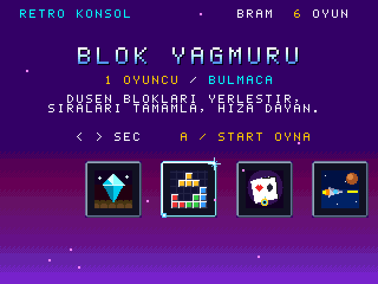

- Üst satırda **RETRO KONSOL**, sağda oyunların nereden okunduğu (**BRAM** ya da flash için **FLASH**, 8. bölüm)
  ve oyun sayısı.
- Ortada seçili oyunun adı büyük harflerle, altında oyuncu sayısı ve türü, iki satırlık açıklaması.
- Altta oyun kartları yan yana durur; seçili kartın çerçevesi nabız gibi parlar ve etrafında iki parıltı döner.
  Seçim değişince şerit yumuşakça kayar, başlık yeniden belirir. Ekranda küçük ışık zerrecikleri yukarı süzülür.

**Gezinmek:** sol/sağ (ya da yukarı/aşağı): kartın butonları, klavyede A/D, W/S ya da ok tuşları, NES kolu.
Her adımda kısa bir ses gelir. **Oynamak:** **A** ya da **Start** (BTNC, Sol Shift, Space, Enter). Ekran kararır,
`YUKLENIYOR` yazar ve oyun başlar.

**Her oyundan geri dönüş:** klavyede **Esc**, kolda **Select + Start** birlikte. Seçme ekranı animasyonsuz
gelir ve son oynanan oyun seçili durur. Kartın kırmızı **CPU RESET** butonu da aynı yere döner.

**Eski metin menüsü ve UART monitörü:** Açılışta (ya da CPU RESET'e basarken) **Select**'i (Tab) basılı tut: boot
ROM'un kendi menüsü ve logosu gelir; burada kartuştaki her şey listelenir ve UART monitörü (5.3) çalışır.

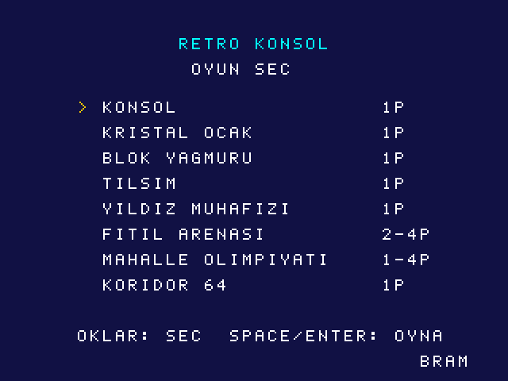

### 5.3 UART (isteğe bağlı ama ilk testte çok faydalı)

VivadoMac'in alt panelindeki **Serial Terminal** sekmesini aç. Portu `/dev/cu.usbserial-…` ile biten
(genelde ikincisi, sonu `1` olan), hızı **115200** seç, **Connect** de. Sonra kartın **CPU RESET** butonuna bas.
Şunu görmelisin:

```
RETRO KONSOL BOOT ROM
K65>
```

Bu yazı geliyorsa işlemci, ROM ve UART çalışıyor demektir; ekran gelmese bile sorunun VGA tarafında olduğunu
gösterir. Kartuştan her yükleme (önce launcher, sonra seçilen oyun) `LOADING` yazar.

Boot ROM menüsündeyken (Select ile açılış, 5.2) basit bir monitör komut alır (yazdıkça ekrana yansır, Enter ile çalışır):

| Komut | Ne yapar | Örnek |
| --- | --- | --- |
| `?` | Komut listesini yazar | `?` |
| `D adres` | O adresten 16 baytı onaltılık gösterir | `D E000` |
| `W adres değer` | Bir bayt yazar, `OK` döner | `W 8406 FF` (alttaki 8 LED yanar) |
| `G adres` | O adrese atlar | `G E000` (yeniden başlatır) |

---

## 6. Oyunlar

Her oyunda bir başlık ekranı çıkar, **A** ya da **Start** ile başlar. Oyun içinde **Start** duraklatır.
**Oyundan çıkmak:** klavyede **Esc**, kolda **Select + Start** her oyunda seçme ekranına döner. Puan oyunun üst satırında ve 7-segment göstergenin sağ dört hanesinde görünür.

### Blok Yağmuru (1 oyuncu)

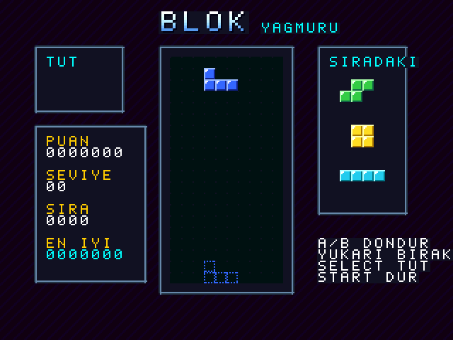

Yukarıdan düşen dört kareli yedi çeşit parçayı 10 x 20'lik kuyuya yerleştir; dolan sıralar parlayıp silinir,
üsttekiler aşağı iner. Başlık ekranında başlangıç seviyesini sol/sağ ile seç (0–9).

- Sol/sağ: kaydır (basılı tutunca hızlanır). **Aşağı**: hızlı düşür (her sıra 1 puan). **Yukarı**: anında bırak
  (sıra başına 2 puan).
- **A**: sağa, **B**: sola döndür (duvara yakınken parça biraz kayarak döner). Klavyede **X** sağa, **Z** sola
  da döndürür (kolun A'sı Sol Shift, B'si Sol Ctrl'dir). **Select** (ya da **C**): parçayı "TUT" kutusuna koy /
  oradakini al (her parçada bir kez). Select bırakıldığında çalışır, böylece Select + Start çıkışla karışmaz.
- **Start** duraklatır; duraklatılmışken **Select** seçme ekranına döner.
- Kesik çizgili **hayalet** parça, parçanın nereye ineceğini gösterir. Sağda sıradaki üç parça görünür.
  Parçalar yedili karışık torbalardan gelir, bu yüzden hiçbir parça çok uzun süre gelmeden kalmaz.
- Puan: 1 sıra 100, 2 sıra 300, 3 sıra 500, 4 sıra (**DORTLU!**, ekran sarsılır) 800, hepsi (seviye + 1) ile
  çarpılır. Her 10 sırada seviye artar ve parçalar hızlanır; arka plandaki melodi de hızlanır.
- Parçalar tepeye dayanınca **OYUN BITTI**. En iyi puan, kart kapanana kadar saklanır.

### Tılsım (1 oyuncu, kart oyunu)

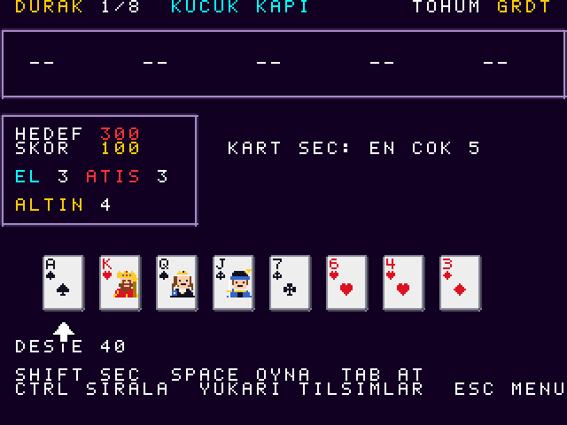

Poker elleriyle oynanan, her koşunun farklı geçtiği bir kart oyunu. Her koşunun dört harfli bir **tohumu**
var (ör. `GRDT`): aynı tohum aynı kartları, aynı pazarları ve aynı bekçileri getirir. Arkadaşına tohumu söyle,
aynı koşuyu o da denesin.

- **Başlık ekranı:** yukarı/aşağı ile satır seç. **DESTE** satırında sol/sağ ile deste:
  *KLASİK* (52 kart), *KOR* (ATEŞ tılsımıyla başlar), *KISA* (2-3-4 yok, 40 kart: kent ve ful kolay),
  *ALTIN* (+6 altın, faiz sınırı 10), *İKİZ* (yalnız kupa ve maça, ikişer: renk kolay). Her destenin kart
  arkası farklı renkte. **TOHUM** satırında sol/sağ harf seçer, A/B harfi değiştirir. **BAŞLA** gösterilen
  tohumla, **YENİ TOHUMLA BAŞLA** rastgele bir tohumla başlatır.
- **Yol:** 8 durak, her durakta üç kapı: **KÜÇÜK KAPI**, **BÜYÜK KAPI** ve **BEKÇİ**. Bekçinin bir laneti
  vardır (ör. *SESSİZ*: atış yok, *SOLUK*: bir renk çip vermez, *YARIM*: çarpan yarıya iner).
  Her kapıdan önce **durak haritası** gelir: üç kapının hedefi ve ödülü, bekçinin laneti ve el seviyeleri
  tablosu. **A** kapıya girer; küçük ve büyük kapıda **B** kapıyı **atlar** ve yazılı **etiketi** verir
  (+10 altın, bir el türüne parşömen, pazarda 3 bedava yenileme, pazarda yarı fiyat, sonraki kapıda +1 el ya
  da hediye tılsım). Atlanan kapının altını ve pazarı yoktur.
- **El:** 8 kart dağıtılır (vale, kız ve papazın kendi portreleri var). Sol/sağ ile kartı seç, **A** ile işaretle
  (en çok 5). **Start** işaretlileri **OYNA**r, **Select** (bırakınca) onları **AT**ar ve yerine yenisini çeker. Her kapıda 4 el ve 3 atış hakkı var.
  **B** sıralamayı değiştirir (sayıya / renge göre).
- **Puan = ÇİP x ÇARPAN.** Elin türü (yüksek kart, çift, iki çift, üçlü, kent, renk, ful, kare, kent renk)
  bir taban çip ve çarpan verir; elin parçası olan her kart kendi değeri kadar çip ekler (2–10 kendi sayısı,
  J Q K 10, As 11). Puanlama adım adım gösterilir: kartların üstünde uçuşan sayılar, artan bir "tık" sesi.
  **A**'yı basılı tutmak hızlandırır.
- **Tılsımlar** (en çok 5, üst şeritte): çarpan ekleyen, çip ekleyen ya da çarpanı katlayan 24 tılsım var.
  Bazıları büyür (*FİDAN*: her çiftli elde kalıcı +1 çarpan; *YANKI*: her kapıda x0,5 daha). Puanlamada etki eden
  tılsımın adı sarı yanar. **Yukarı** ile tılsımlara geçip açıklamalarını okuyabilirsin.
- **Pazar:** her kapıdan sonra altın kazanırsın (kalan her el +1, her 5 altın için +1 faiz). Pazarda iki tılsım
  ve bir **parşömen** (bir el türünün seviyesini yükseltir) satılır. **A** al, **Select** yenile (her seferinde
  pahalanır), **Yukarı** sonra **A** bir tılsımı yarı fiyatına sat, **Start** devam.

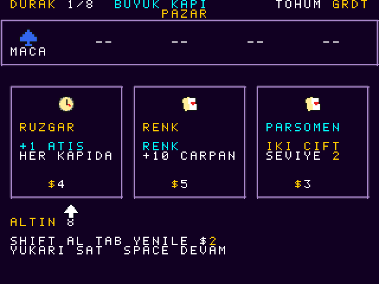
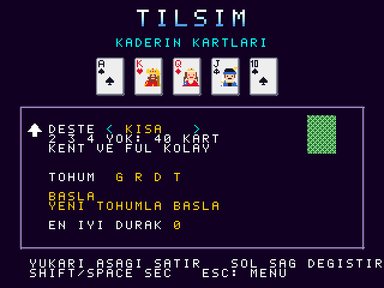
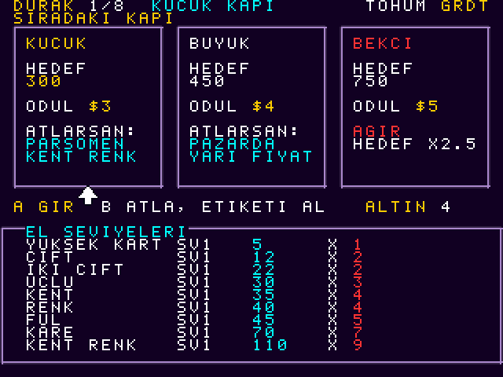

- 4 elde hedefe ulaşamazsan **TILSIM BOZULDU**: ulaştığın durak, koşunun en iyi eli ve başa dönüş. 8. durağın
  bekçisini geçersen **TILSIM KIRILDI!** ve hedefler katlanarak sonsuz devam eder.
- Başlık ekranında **A** yeni rastgele bir tohumla başlatır, **Start** gösterilen tohumla. Yön tuşlarıyla
  tohumun harflerini tek tek değiştirebilirsin.

### Kristal Ocak (1 oyuncu)

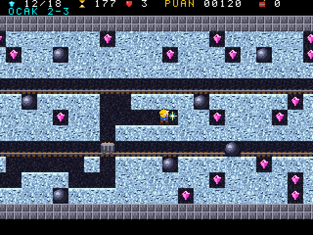

Madende toprağı kazarak ilerle, turkuaz kristalleri topla. Gerekli sayıda kristal toplanınca çıkış kapısı
sarı olur; kapıya ulaşınca bölüm biter. Kayalar ve kristaller boşluğa düşer, yuvarlak şeylerin üstünden yana
yuvarlanır; **düşen bir kaya seni ezer**. Kayaları yana itebilirsin (arkası boşsa). 3 bölüm, 3 can, her bölüm
150 saniye.

- Yön tuşları: hareket.
- Üst satır: `KRISTAL 00/10  SURE 150  CAN 3`, altında `PUAN`.
- Harita ekrandan geniş, kahraman ilerledikçe kayar; üst satır sabit kalır (ekranın ortasında yatay kaydırmanın
  değişmesi, PPU'nun raster kesmesiyle yapılıyor).

### Yıldız Muhafızı (1 oyuncu)

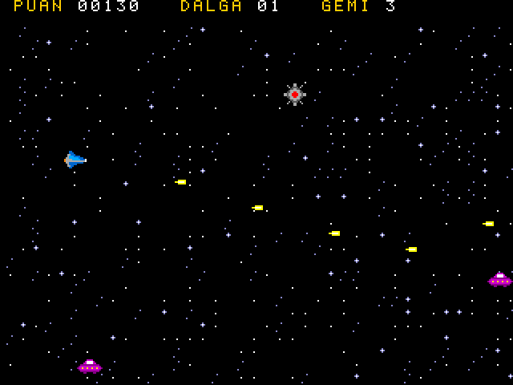

Yıldızların arasında sağa doğru uçan bir uzay atıcısı. Daireler dalgalanarak gelir ve ateş eder, oklar hızlı
ve düz gelir, mayınlar üç isabette patlar.

- Yön tuşları: gemi. **A**: ateş (basılı tutunca seri atar).
- Üst satır: `PUAN`, `DALGA`, `GEMI` (can). Puan arttıkça dalga ilerler ve düşmanlar sıklaşır.
- Vurulunca gemi bir süre yanıp söner (bu sürede hasar almaz).

### Fitil Arenası (2–4 oyuncu)

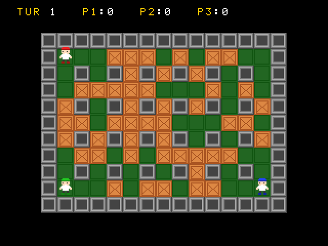

Kurulum ekranında **OYUNCU SAYISI**'nı yukarı/aşağı ile seç (2–4), **Start** ile başlat. Her oyuncu kendi
kolunu kullanır (1. ve 2. oyuncu klavyeyi de kullanabilir, 7. bölüm). Oyuncular kırmızı, mavi, yeşil ve sarı.

- Yön tuşları: yürü. **A**: bomba bırak.
- Bomba yaklaşık 2,5 saniye sonra artı şeklinde patlar. Kahverengi sandıkları kırar; sandıktan bazen güç çıkar:
  bomba sayısı, patlama menzili, hız.
- Alevin içinde kalan elenir. Bombalar birbirini patlatabilir.
- Son ayakta kalan turu alır; üç tur kazanan maçı alır. Üst satırda tur ve skorlar (`P1:0  P2:0 …`).

### Mahalle Olimpiyatı (1–4 oyuncu, sırayla)

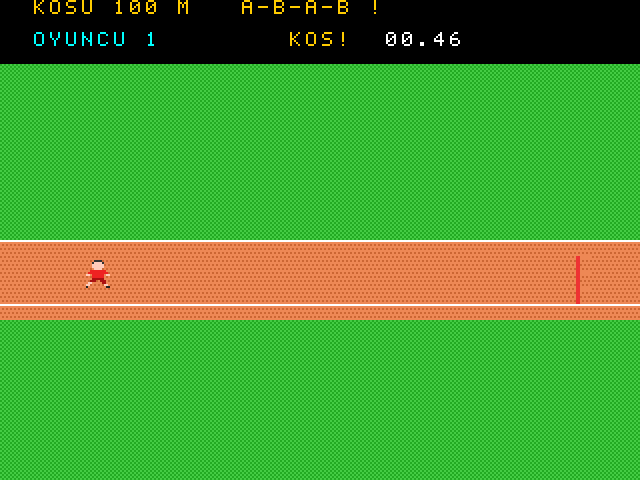

Oyuncu sayısını seç, sonra üç yarışma sırayla oynanır. Her turda ekranda `OYUNCU n HAZIR: A` yazar: o oyuncu
kendi kolunun ya da 1. kolun **A**'sına basar.

1. **KOSU 100 M**: 3-2-1 geri sayımından sonra **A** ve **B**'ye sırayla, olabildiğince hızlı bas. Süre sağ üstte.
2. **UZUN ATLAMA**: A-B ile koş, kırmızı çizgiye gelmeden **yukarı** ile atla. Çizgiye ne kadar yakın atlarsan o
   kadar uzağa gidersin; çizgiyi geçersen **FAUL**. İki deneme, iyisi sayılır.
3. **REFLEKS**: `HAZIR...` yazısından sonra bekle; arka plan kırmızı olup `SIMDI!` yazınca hemen **A**'ya bas.
   Erken basmak faul sayılır. Süre milisaniye olarak yazar.

Her yarışmadan sonra puan tablosu gelir (birinci 4, ikinci 3, üçüncü 2, dördüncü 1 puan). Sonunda
`SAMPIYON: OYUNCU n`.

---

## 7. Kontroller

| | 1. oyuncu | 2. oyuncu | 1–4. oyuncu |
| --- | --- | --- | --- |
| Yönler | W A S D, kart butonları (BTNU/BTND/BTNL/BTNR) | Ok tuşları | NES/SNES kolu |
| A | Sol Shift, BTNC (orta buton) | Sağ Ctrl | A |
| B | Sol Ctrl | Sağ Shift | B |
| Select / Start | Tab / Space | Backspace / Enter | Select / Start |
| Menüye dön | Esc | Esc | Select + Start |

Kart butonları ve klavye, 1. oyuncunun kolunun yerine geçer, ikisi aynı anda da çalışır.

**NES/SNES kolu bağlantısı (Pmod JA, üst sıra 1–4, alt sıra 7–10):**

| Pmod JA pini | Sinyal |
| --- | --- |
| JA1 | LATCH (tüm kollara ortak) |
| JA2 | CLOCK (tüm kollara ortak) |
| JA3 | 1. kol DATA |
| JA4 | 2. kol DATA |
| JA7 | 3. kol DATA |
| JA8 | 4. kol DATA |
| VCC / GND | Kolların 3,3 V beslemesi ve toprağı |

Kolları **3,3 V'tan besle, 5 V kullanma**: 5 V'luk DATA hattı FPGA pinine zarar verebilir. İlk kolu takmadan
önce DATA hattını multimetreyle ölçmek iyi olur.

**Klavye hakkında:** Ucuz klavyeler aynı anda basılan bazı tuş kombinasyonlarını iletmez (ghosting). Kartın USB
denetleyicisi de en fazla 6 normal tuş + Shift/Ctrl gibi tuşları geçirir. İki kişi tek klavyede oynarken bazı
tuşlar takılırsa bu donanım sınırıdır.

---

## 8. Oyunları flash'a yazmak (güç verince kendiliğinden açılsın)

Bu adım isteğe bağlı. Yapılınca kart, bilgisayara bağlı olmadan da açılışta menüye gelir.

1. **Program Device**'ı aç, bitstream yolu aynı kalsın.
2. **Program configuration memory (SPI flash)** kutusunu işaretle. Altında iki alan açılır:
   - **Data file**: `amiral64/sw/build/cart.bin`
   - **Flash offset**: `0x400000` (varsayılan değer)
3. **Program** de. Önce bitstream flash'a yazılır ve doğrulanır, sonra kartuş verisi; toplam 30–60 saniye.
   Messages'ta `Configuration memory programmed and verified` ve `cart.bin written to flash at 0x400000 and
   verified` yazar.
4. Kartı kapat. **JP1 (MODE) jumper'ını QSPI** konumuna al. Kartı aç.
5. Birkaç saniye içinde logo, sonra menü gelir. Menünün sağ alt köşesinde artık **FLASH** yazar.

Tcl Console'dan aynısı: `program_hw_cfgmem`, ardından `vivadomac_write_flash -offset 0x400000 sw/build/cart.bin`.

Flash'ta geçerli bir kartuş varsa boot ROM onu kullanır, yoksa bitstream'in içindekini (**BRAM**). Flash'taki
oyunları değiştirmek için yalnızca 1–3. adımlar yeterlidir.

---

## 9. Kartta yapılacak testlerin listesi

Sırayla dene ve her biri için ✓ ya da gördüğün farkı not al:

- [ ] Programlamadan sonra parıltılı açılış animasyonu ve arpej geliyor (5.1)
- [ ] Seçme ekranında altı oyun kartı var, sağ üstte `BRAM`; sol/sağ ile şerit kayıyor, başlık değişiyor (5.2)
- [ ] Bir oyundan Select + Start ile dönünce animasyonsuz, aynı oyun seçili geliyor
- [ ] Select basılıyken CPU RESET: boot ROM menüsü; Serial Terminal'de `RETRO KONSOL BOOT ROM` ve `K65>` (5.3)
- [ ] Monitörde `W 8406 FF` yazınca alttaki 8 LED yanıyor
- [ ] Klavye: A/D ile seçme ekranında gezinme; oyunda W+A+Sol Shift ile Yukarı+Sol+Sağ Ctrl aynı anda
- [ ] NES kolu: menüde gezinme, Fitil Arenası'nda her kolun kendi oyuncusu
- [ ] Kristal Ocak: kazma, düşen kaya, kristal toplama, üst satırın kaymadan durması
- [ ] Yıldız Muhafızı: ateş sesi, patlama, düşman ateşi
- [ ] Fitil Arenası: 2–4 oyuncuyla bir maç
- [ ] Mahalle Olimpiyatı: üç yarışma ve şampiyon ekranı
- [ ] Blok Yağmuru: döndürme, tutma, sıra silme, dörtlüde ekran sarsıntısı, seviye artınca hızlanma
- [ ] Tılsım: el oynama ve atma, puanlamanın adım adım gösterilmesi, kapı açılınca pazar, tılsım alıp satma
- [ ] Flash'a yazıp JP1 QSPI'deyken güç verince menünün `FLASH` ile gelmesi (8. bölüm)

---

## 10. Sorun giderme

| Belirti | Olası neden ve çözüm |
| --- | --- |
| Open Target'ta cihaz yok | Kablo **PROG/UART** portunda mı, kart açık mı? Başka bir program (ör. açık bir seri terminal) USB'yi tutuyor olabilir; kabloyu çıkarıp tak |
| Program Device hata veriyor | Messages'taki satırı not al. Güç anahtarını kapatıp aç, tekrar dene |
| Ekran siyah, monitör "sinyal yok" diyor | VGA kablosu ve monitör girişi. Serial Terminal'de `RETRO KONSOL BOOT ROM` geliyorsa tasarım çalışıyor, sorun görüntü tarafında |
| Ekran siyah, UART'ta da bir şey yok | CPU RESET'e bas. Hâlâ yoksa bitstream'in doğru yüklendiğinden emin ol (Messages). Bu, kartta ilk kez denenen bitstream olduğu için bildirilmesi gereken önemli bir bulgudur |
| Görüntü kaymış, titriyor | Monitörün otomatik ayarını kullan; çözünürlük 640x480 @ 60 Hz |
| Seçme ekranı yerine boot ROM menüsü geliyor | Açılışta Select (Tab) basılı mı, ya da bir NES kolunda Select takılı mı kalmış? Kartuş eski (launcher'sız) olabilir: `make -C sw` ve yeniden bitstream |
| Sentez `bram: cannot open cart_10.mem` hatasıyla duruyor | Proje, kartuş 128 KB'a (32 blok) büyümeden önce oluşturulmuş: içinde yalnızca `cart_00…0f.mem` var. `vivado/create_project.tcl`'i yeniden çalıştır (2. bölüm) ya da Tcl Console'da `add_files ../sw/build/cart_10.mem` … `cart_1f.mem` |
| Menüde `KARTUS BULUNAMADI` | `make -C sw` çalıştırılmadan bitstream üretilmiş olabilir. `make -C sw`, sonra yeniden Generate Bitstream |
| Ses yok | Kulaklığı kartın ses jakına tak, sesi biraz aç. Açılış melodisi her resetten sonra çalar |
| Klavye çalışmıyor, BUSY (sarı) LED yanıp sönüyor | PS/2 hatlarında FPGA'nın pull-up'ları yoksa PIC24 tuşları gönderemez. 20 Kasım'dan önceki bitstream'lerde bu eksikti: VivadoMac'i ve bitstream'i yeniden üret. Klavyeyi **USB HOST** portuna doğrudan tak (hub olmaz) |
| Klavye hâlâ çalışmıyor | Serial Terminal'de W'ye basılı tutarken `D 8210` yaz: dördüncü bayt `20` olmalı. Hep `00` ise tuş FPGA'ya ulaşmıyor; başka (sade, multimedya tuşsuz) bir USB klavye dene |
| Flash'tan açılmıyor | JP1 QSPI'de mi? 8. bölümdeki iki yazma işlemi de `verified` ile bitti mi? |

---

## 11. Karta yüklemeden denemek

**Sanal kart (asıl tasarım):** VivadoMac'te Flow Navigator > **Virtual Board**. Sentezlenen tasarımın kendisi
Verilator ile Mac'te çalışır: VGA ekranı, LED'ler, 7-segment, switch'ler, butonlar ve UART ekranda; ekrana
tıklayınca Mac klavyesi kartın USB klavyesi olur (sağ ⌘ = Sağ Ctrl). Pencerede hangi Mac tuşunun hangi konsol
düğmesi olduğunu gösteren bir tablo var; basılı tuşlar orada yanar. Gerçek hızın yaklaşık onda biriyle çalışır,
yani oyunlar ağır çekimde akar ama donanımın doğru çalışıp çalışmadığı birebir görülür. İlk açılışta sentez ve
derleme bir iki dakika sürer. `tests/run_tests.sh vboard` aynı şeyi pencere açmadan dener.

**Emülatör (yalnızca yazılım, gerçek hızda):**

Kart yokken oyunları Mac'te Python emülatörüyle çalıştırıp ekran görüntüsü alabilirsin:

```sh
python3 tools/emu6502.py run sw/build/boot.bin --cart sw/build/cart.bin --frames 150 --png menu.png
```

Açılışta launcher gelir (yaklaşık 50. karede seçme ekranı). `--pad1 "160:04,170:00,180:80"` gibi bir parametreyle belirli karelerde kol tuşu basılabilir (onaltılık:
`80` A, `40` B, `20` Select, `10` Start, `08` yukarı, `04` aşağı, `02` sol, `01` sağ).

## 12. Testler

```sh
tests/run_tests.sh          # hepsi (yaklaşık 10 dakika)
tests/run_tests.sh sw       # yazılım: emülatörde boot ROM, launcher ve altı oyunun senaryolu testleri, ekran görüntüleri sw/build/shots
tests/run_tests.sh sim      # VHDL testbench'leri (GHDL)
tests/run_tests.sh flow     # VivadoMac ile sentez, yerleştirme, bitstream
```

## 13. Klasörler

| Klasör | İçerik |
| --- | --- |
| `hw/` | Sentezlenen VHDL. Üst seviye: `konsol_top` (pinler, MMCM, STARTUPE2), içinde `konsol_core` |
| `hw/t65/` | T65 6502 çekirdeği (BSD benzeri lisans, `NOTICE.md`) |
| `hw/sim/` | Testbench'ler ve simülasyon modelleri (Xilinx primitive'leri, SPI flash) |
| `constr/` | Nexys 4 DDR pinleri |
| `sw/` | 6502 yazılımı: `boot/` boot ROM, `lib/` C oyun kütüphanesi (`bigtext.c`: büyük gölgeli başlık harfleri), `games/` launcher ve altı oyun, `tests/` |
| `tools/` | `emu6502.py`, `ppu_model.py`, `gfx.py` (metin çizimden karo/sprite), `font.py`, `mkcart.py`; `art/` launcher, Blok Yağmuru ve Tılsım grafiklerini üreten betikler (`art.txt` dosyaları bunlardan üretilir), `art/preview.py` bir `art.txt`'yi PNG'ye döker |
| `vivado/` | `create_project.tcl`, `build_bitstream.tcl`, `sources.tcl` |
| `docs/` | Bu belgedeki ekran görüntüleri (emülatörden) |

## 14. Donanım özeti

- Tek saat: 100 MHz osilatörden MMCM ile 25 MHz. İşlemci saat yetkilendirmesiyle 6,25 MHz'te (ya da 1,79 MHz)
  çalışır.
- Bellek haritası: `$0000-$7FFF` RAM, `$8000-$8FFF` G/Ç, `$9000-$DFFF` oyun RAM'i, `$E000-$FFFF` boot ROM.
  Oyunlar `$9000`'a yüklenir (en çok 20 KB); daha büyükleri (Tılsım, 25 KB) `$0400`'e yüklenir, değişkenleri
  `$9000`'da durur (`sw/game_c_low.cfg`). Kartuş dizinindeki her kayıt kendi yükleme adresini taşır.
  `$02E0-$02FF`: oyunlar arası küçük kayıt alanı (en iyi puanlar, launcher'ın son seçimi).
- Kartuş: 128 KB (32 x 4 KB blok RAM), dizinde en çok 8 kayıt; ilk kayıt bayrağıyla launcher olabilir. Boot ROM
  `$FFF0`'da bir giriş sunar: `A` = dizin sırası ile `JSR $FFF0` o oyunu yükleyip başlatır.
  Register listesi: `sw/include/konsol.inc` ve `hw/` içindeki her bloğun baş açıklaması.
- PPU: 320x240, VGA 640x480 @ 60 Hz'te 2 kat büyütülmüş; 64x32 karo haritası ve kaydırma; 256 karo; 16x16'lık 64
  sprite (satır başına 16); 16 palet x 16 renk (4096 renkten); vblank NMI, raster IRQ, OAM DMA, çarpışma bayrakları.
- APU: 2 kare dalga, üçgen, gürültü, sönümlenen zarf; açık-drenaj `AUD_PWM` üzerinden birinci dereceden
  delta-sigma çıkış.
- Kaynak kullanımı: yaklaşık 3.000 LUT ve 45 blok RAM (XC7A100T'nin %5'i ve %33'ü).
